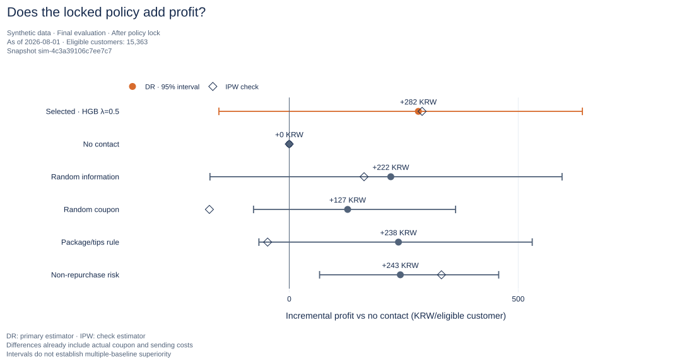

# CRM Retention Lab

**After a first purchase, who should receive a reminder, a coupon, or no message?**

A marketing planning portfolio for a fictional direct-to-consumer coffee retailer. The project combines repurchase analysis, a three-arm randomized experiment, and uplift modeling to evaluate customer-level CRM decisions under budget, contact, and side-effect constraints.

**[Final PDF](output/pdf/CRM_FINAL_REPORT.pdf)** · **[Interactive report](reports/CRM_DIAGNOSTIC.html)** · [Quick start](#quick-start) · [Policy specification](docs/STAGE_4_POLICY_SPEC.md)

Python · Kaplan–Meier · Randomized experiments · T-learner · DR / IPW · Plotly + Quarto

> **Decision: modify the campaign or collect more evidence.** The locked policy meets the budget, contact, and two side-effect criteria. Estimated incremental contribution profit is **+KRW 282 per eligible customer**, with a **95% interval of −KRW 154 to +KRW 640**. The evidence does not establish a profit improvement.
>
> All data are generated for this project. Results describe a fixed synthetic world; they do not establish performance for a real retailer.



The highlighted row is the policy selected on validation data and locked before final evaluation. Other rows are prespecified exploratory baselines; they are not used to reselect a policy after seeing final results.

<details>
<summary>Contents</summary>

- [Business question](#business-question)
- [Key results](#key-results)
- [Analysis workflow](#analysis-workflow)
- [Data and scope](#data-and-scope)
- [Quick start](#quick-start)
- [Repository structure](#repository-structure)
- [Validation and limitations](#validation-and-limitations)
- [Documentation](#documentation)
- [References and license](#references-and-license)

</details>

## Business question

A customer who has not purchased again may respond to useful information, need an incentive, or return without intervention. Sending the same coupon to everyone can spend money on purchases that would have happened anyway.

Which action adds contribution profit after discounts, refunds, product costs, shipping, payment fees, and message costs?

| Action | Campaign treatment | Comparison it supports |
|---|---|---|
| No contact (`control`) | No additional marketing message | Natural repurchase |
| Information (`info`) | One message with storage/brewing tips and a repurchase reminder | Incremental value of information |
| Information + coupon (`coupon`) | The same message plus a KRW 3,000 coupon | Added value of the discount |

Customers become eligible at D+14 after their first delivery if they have not repurchased and meet order-status, consent, and email requirements. Essential order/shipping notices are identical across arms. The coupon applies once to a merchandise purchase of at least KRW 25,000 and expires after 14 days.

## Key results

The independent final evaluation includes **15,363 assigned customers**. Every eligible customer remains in the denominator, including customers whom the policy would not contact.

| Locked policy | Final result |
|---|---|
| Selected policy | HGB T-learner; reservation-cost penalty λ=0.5 |
| DR incremental contribution profit | +KRW 281.94 per eligible customer; 95% interval −KRW 153.63 to +KRW 640.13 |
| IPW check estimate | +KRW 290.12 per eligible customer |
| Recommended actions | No contact: 11,045; information: 2,834; information + coupon: 1,484 |
| Contact rate | 28.11%; 4,318 contacts against a total daily-cap allowance of 4,583 |
| Reserved variable cost | KRW 4,538,360 against summed daily caps of KRW 4,608,900 |
| Unsubscribe increase | One-sided 97.5% upper bound: +0.371 percentage points; tolerance: +0.5 |
| Refund-customer increase | One-sided 97.5% upper bound: +0.742 percentage points; tolerance: +1.0 |
| Planning decision | Modify operating conditions or collect more evidence |

The same locked policy estimated +KRW 1,010.73 per customer on validation data and +KRW 281.94 on final data. Sampling variation, selection optimism, and customer composition are possible explanations; this comparison does not identify the cause.

The earlier training experiment estimates +KRW 888 for information versus no contact and +KRW 2,199 for information + coupon versus no contact. These are average randomized-arm effects, not the value of a policy constrained by contact and budget limits. [Three-arm results](docs/STAGE_3_RESULTS.md).

## Analysis workflow

1. **Define the decision.** Specify eligibility, messages, coupon terms, accounting, observation windows, and operating constraints.
2. **Diagnose natural repurchase.** Use the no-contact training arm to examine cohorts, Kaplan–Meier curves, and package-size differences.
3. **Compare randomized treatments.** Apply ITT, Welch mean differences, Holm correction, assignment/balance checks, and ledger reconciliation. Compare the active arms directly to assess the added value of the coupon.
4. **Learn and lock a policy.** Fit Ridge and HGB T-learners on training customers; compare eight fixed model/penalty candidates on validation customers. Apply daily contact, reservation-budget, and predicted-risk constraints.
5. **Evaluate independently.** Estimate incremental profit with DR, check it with IPW, and use 2,000 within-day bootstrap resamples with allocation recalculated in each resample.

## Data and scope

The generator produces customers, orders, order events, financial ledger entries, behavioral events, assignments, contacts, and eligibility audits.

| Split | Assigned customers | Use |
|---|---:|---|
| Training | 15,284 | Diagnosis, arm comparisons, and model fitting |
| Validation | 15,167 | Prespecified candidate comparison and selection |
| Final evaluation | 15,363 | Evaluation of the locked policy |

Each split has an independent generation profile of 20,000 customers. Generated populations and eligible assigned-customer counts are different quantities. Outcomes cover additional payments in the 60 days after assignment, followed by 30 days for settlement. The first order's profit is excluded.

The repository includes a [small synthetic schema sample](data/sample/README.md), public aggregates, source code, configuration, and reports. Full generated records, hidden generator state, fitted models, and customer-level recommendations are excluded from Git. Hidden state is not used for fitting, selection, or evaluation.

## Quick start

### View the results

Open the [PDF](output/pdf/CRM_FINAL_REPORT.pdf), or download [the HTML report](reports/CRM_DIAGNOSTIC.html) and open it in a browser. The HTML includes Plotly locally and works offline. GitHub's file view does not run interactive charts. GitHub Pages is not deployed.

### Rebuild from public aggregates

Recorded environment: **Python 3.14.3**, **Plotly 7.1.0**, **scikit-learn 1.9.1**, **Quarto 1.11.9**. From the repository root:

```bash
python -m venv .venv
```

Activate with `.venv\Scripts\Activate.ps1` in PowerShell or `source .venv/bin/activate` on macOS/Linux, then run:

```bash
python -m pip install -r requirements-analysis.lock.txt
python scripts/refresh_report.py
python scripts/render_report.py
```

Quarto must be on `PATH`; otherwise pass `--quarto` with its executable path. The refresh verifies aggregate hashes and rebuilds all 14 charts, the Quarto source, and the local Plotly bundle without refitting, reselecting, or re-estimating. Add `--static-svg` to refresh SVGs; it requires Kaleido and Chrome.

See the [run guide](docs/RUN_GUIDE.md) for Windows temporary-path settings, PDF generation, and full data/model reproduction.

### Run checks

```bash
python scripts/run.py test
```

Generator and data-contract checks support Python 3.10+ without third-party packages. Complete numerical and visualization checks require the pinned analysis environment.

## Repository structure

```text
crm-retention-lab/
├── configs/                       # Fixed experiment, generator, and policy settings
├── data/sample/                   # Small synthetic schema example
├── docs/                          # Design, methods, results, and run guide
├── src/crm_retention_lab/          # Generator, contracts, accounting, models, evaluation
├── scripts/                       # CLI entry point and report/PDF renderers
├── tests/                         # Numerical, accounting, timing, and report checks
├── report/
│   ├── index.qmd                  # Generated Quarto source
│   ├── data/                      # Public aggregates and provenance manifest
│   └── assets/figures/            # Plotly HTML/JSON and static SVG charts
├── reports/                       # Standalone HTML and validation records
├── output/pdf/                    # Final PDF and rendering manifest
└── requirements-analysis.lock.txt
```

## Validation and limitations

Checks cover eligibility, temporal leakage, settlement, financial reconciliation, immutable inputs, hidden-state exclusion, model/selection separation, daily caps, and report consistency. Numerical methods are cross-checked against established libraries. See the [validation records](reports/STAGE_4_VALIDATION.md) and [English release verification](reports/ENGLISH_RELEASE_VALIDATION.md).

- **Synthetic scope:** results do not demonstrate real customer behavior or real-brand profit improvement.
- **Timing:** D+14 is fixed; this experiment cannot identify the best sending day.
- **Individual effects:** one assigned treatment outcome is observed per customer. Model differences estimate conditional average effects, not observed individual causal effects.
- **Uncertainty:** final intervals condition on the locked models/policy and observed daily composition. They do not include all training or real-market generalization uncertainty.
- **Allocation:** the greedy allocator respects implemented constraints but does not guarantee a global optimum.
- **Remaining work:** independent pilot power simulations, repeated A/A inference checks, and external validation are incomplete. Discrete-time survival modeling and action-specific potential-outcome tables remain planned work.

## Documentation

| Read this for… | Document |
|---|---|
| Business framing and campaign hypotheses | [Project design](docs/PROJECT_DESIGN.md) |
| Definitions and generation assumptions | [Data design](docs/DATA_DESIGN.md) |
| Repurchase diagnosis | [Stage 2 methods](docs/STAGE_2_METHODS.md) |
| Three-arm experiment and accounting | [Stage 3 results](docs/STAGE_3_RESULTS.md) |
| Prespecified policy selection/evaluation | [Stage 4 specification](docs/STAGE_4_POLICY_SPEC.md) |
| Final policy decision | [Stage 4 results](docs/STAGE_4_RESULTS.md) |
| Environment, commands, and outputs | [Run guide](docs/RUN_GUIDE.md) |

## References and license

Method and project references are in [REFERENCES.md](docs/REFERENCES.md). The README adapts presentation patterns from actual analytics portfolios and project templates; [comparison notes](docs/README_REFERENCE_NOTES.md) identify the sources.

A project license has not been selected. No license grant is stated. Publishing configuration is documented in [GitHub preparation](docs/GITHUB_PREPARATION.md).
